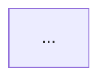

# Generate Model Diagram PNG

Quick guide to generate a PNG diagram from the Mermaid model relationship diagram.

## Quick Start

```bash
npm run generate-model-diagram
```

This will:

1. Extract the Mermaid diagram from `docs/models-relationship-diagram.md`
2. Convert it to PNG format
3. Save it as `docs/models-diagram.png`

## Requirements

`@mermaid-js/mermaid-cli` is not a project dependency. The script uses a global `mmdc` if you have one, and otherwise runs it through `npx`, which downloads it (and a headless Chromium) on first use.

## Manual Steps

If you prefer to run manually:

```bash
# Run the script
./scripts/generate-model-diagram-to-png.sh
```

## Output

The PNG will be saved to:

- `docs/models-diagram.png` (2400x1800px, transparent background)

## Updating the Diagram

1. Edit the Mermaid diagram in `docs/models-relationship-diagram.md`
2. Run `npm run generate-model-diagram`
3. The PNG will be regenerated with your changes

## Troubleshooting

### "mmdc not found"

The script falls back to `npx --yes @mermaid-js/mermaid-cli`. If that fails, install it globally:

```bash
npm install --global @mermaid-js/mermaid-cli
```

### "Could not find Mermaid diagram"

Make sure `docs/models-relationship-diagram.md` contains a Mermaid code block:

````markdown

````

````

### PNG is too small/large
Edit the script `scripts/generate-model-diagram-to-png.sh` and change:
```bash
-w 2400 -H 1800  # width x height in pixels
````
